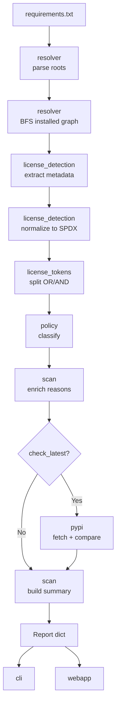

# Architecture Overview

LicenseGuard is organized into focused modules with a one-directional data flow.

---

## Module map

| Module | Responsibility |
|---|---|
| `licenseguard.resolver` | Requirements parsing and installed dependency graph traversal |
| `licenseguard.license_detection` | Extract and normalize license metadata |
| `licenseguard.license_tokens` | OR/AND tokenization and drift comparison |
| `licenseguard.policy` | Built-in and file-backed classification rules |
| `licenseguard.scan` | Orchestrates the scan and assembles the report |
| `licenseguard.pypi` | Optional latest-release metadata retrieval and caching |
| `licenseguard.webapp` | FastAPI application and embedded dashboard |
| `licenseguard.cli` | Command entry point and terminal UX |

---

## Scan pipeline



In sequence:

1. Load roots and resolve installed packages.
2. Build row data from installed distributions.
3. Classify status and reason via policy logic.
4. Append advisory notes, such as unpinned direct dependencies.
5. Optionally enrich rows with PyPI drift fields.
6. Build the summary and return the report.

---

## Design principles

- **Prefer installed-runtime truth over declared intent.** The report describes the environment, not the wish list.
- **Separate parsing, resolution, classification, and presentation.** Each stage is independently testable and replaceable.
- **Keep warnings explicit and non-blocking.** A malformed requirement line degrades one row, not the whole scan.
- **Keep the frontend framework-free.** Operational simplicity over tooling sophistication.

[:octicons-arrow-right-24: The reasoning behind these](design-decisions.md)

---

## Data contracts

| Boundary | Shape |
|---|---|
| Resolver output | `ResolvedPackage` records |
| Scan output | Serializable row dictionaries |
| Summary | Derived from status counts over the row set |
| Consumers | CLI and web consume the identical report shape |

A single report shape for both front-ends means the dashboard can never drift from CLI behavior — they are rendering the same data.

[:octicons-arrow-right-24: Report schema](../api/report-schema.md)

---

## Resolution model

Resolution is installed-only:

1. Parse direct roots from `requirements.txt`.
2. Build the installed distribution map from `importlib.metadata.distributions()`.
3. Walk `requires_dist` breadth-first, following only installed dependencies.
4. Skip missing dependencies silently.

[:octicons-arrow-right-24: Installed-only resolution in depth](../core-concepts/installed-only.md)

---

## Web architecture

The dashboard is a local FastAPI service holding session state in memory:

- current requirements path
- current policy configuration or path
- drift flags and cache path
- the most recent scan result, used by download endpoints

The frontend is a single HTML page with vanilla JavaScript and CSS embedded in `webapp.py`. No framework, no build step.

---

## Performance characteristics

| Area | Approach |
|---|---|
| Distribution map | Built once, memoized with `functools.lru_cache` |
| License summaries | Cached by `(name, version)` |
| Dashboard rendering | Lazy sections, paged rows (100 per page) |
| Drift mode | Network-bound; in-memory plus optional disk cache |

Offline scans of a few hundred packages complete in well under a second. Drift mode is dominated by network round-trips, which is what the cache exists to amortize.

---

## Testing

The suite covers the three layers independently:

| File | Scope |
|---|---|
| `tests/test_licenseguard.py` | Resolution, detection, normalization, policy, tokens |
| `tests/test_cli.py` | Argument handling, output modes, exit codes |
| `tests/test_webapp.py` | Endpoints, scan lifecycle, downloads |

```bash
pytest -q
```

---

## Extension points

Natural places to build on the existing structure:

- Organization-specific policy presets
- SARIF or SPDX document export formatters
- A persistent report storage backend
- Richer diffing between consecutive scans
- Additional ecosystems behind the resolver interface

---

## Related

- [Design decisions](design-decisions.md) — tradeoffs and rationale
- [Python API](../api/python-api.md) — programmatic use
