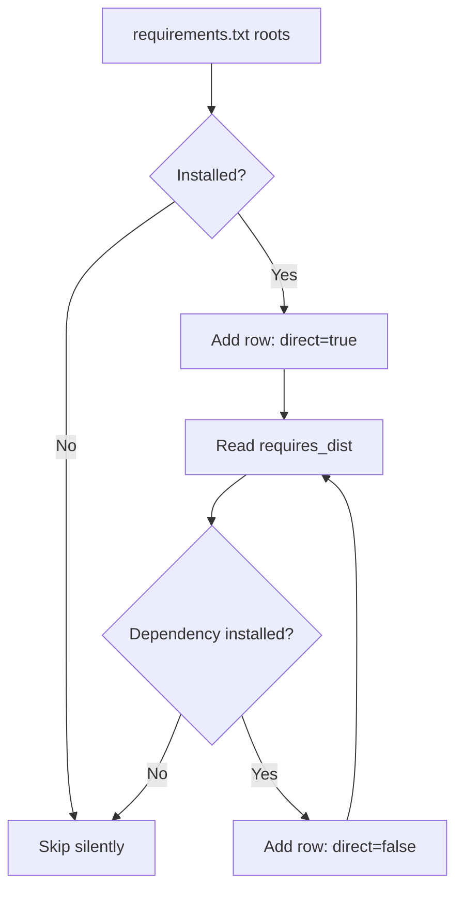

# Installed-Only Resolution

LicenseGuard's central design decision: **report on what is installed, not on what is declared.**

---

## How resolution works

1. Parse direct roots from `requirements.txt`.
2. Build a map of installed distributions from `importlib.metadata.distributions()`.
3. Walk `requires_dist` breadth-first from each root.
4. Follow only those dependencies that appear in the installed map.
5. Skip anything missing, silently.



The traversal is breadth-first and deduplicates by canonical name, so each distribution appears exactly once regardless of how many packages depend on it.

---

## Why this matters

Most license scanners resolve from a lockfile or query PyPI metadata for declared dependencies. That approach reports on an *intended* dependency set. LicenseGuard reports on the *actual* one.

This avoids false positives from:

- **Stale requirements files** — entries that were never installed, or removed packages still listed
- **Optional declarations** — extras declared in `requires_dist` but not selected at install time
- **Environment markers** — platform- or version-gated dependencies that do not apply to this environment
- **Unresolved transitives** — dependencies of packages that were themselves never installed

What you scan is what actually ships.

---

## The tradeoff

!!! warning "The environment must be complete"
    Installed-only resolution is only as accurate as the environment it runs in. Scanning a partially installed environment produces a partial report.

    In CI, always install the full dependency set **before** scanning:

    ```bash
    pip install -r requirements.txt
    licenseguard scan requirements.txt --cli
    ```

A second consequence: LicenseGuard cannot tell you about a dependency you have not installed yet. To evaluate a prospective upgrade, install it first, or use [drift analysis](../drift/overview.md) to compare against the latest published release.

---

## Direct versus transitive

Every row carries a `direct` boolean:

| Value | Meaning |
|---|---|
| `true` | The package appears in `requirements.txt` |
| `false` | The package was reached by walking another package's dependencies |

This distinction matters because the two call for different remediation. A problematic **direct** dependency is yours to replace. A problematic **transitive** dependency usually requires upgrading or replacing whichever direct dependency pulls it in.

The CLI table and the dashboard both separate these groups, and CSV export preserves the ordering — direct first, then transitive.

---

## Requirement parsing details

The resolver handles:

- standard PEP 508 requirements (`requests>=2.0,<3`)
- editable installs (`-e`, `--editable`) and egg fragments
- comments and blank lines (ignored)
- name canonicalization, so `Flask`, `flask`, and `FLASK` resolve identically

!!! note "Include directives"
    `-r` / `--requirement` and `-c` / `--constraint` includes are recognized during parsing, but the resolver does not recurse into referenced files to discover additional roots. Point LicenseGuard at the file that lists the dependencies you want evaluated, or rely on transitive traversal to reach the rest.

Lines that cannot be parsed into a package root emit a warning and the scan continues.

---

## Performance

The installed distribution map is built once per process and memoized with `functools.lru_cache`, so repeated lookups during graph traversal are cheap. License summaries are cached by `(name, version)`.

For a typical application with a few hundred resolved packages, a scan completes in well under a second when drift analysis is disabled.

---

## Related

- [License detection](license-detection.md) — what happens to each resolved package
- [Architecture overview](../architecture/overview.md) — where resolution sits in the pipeline
