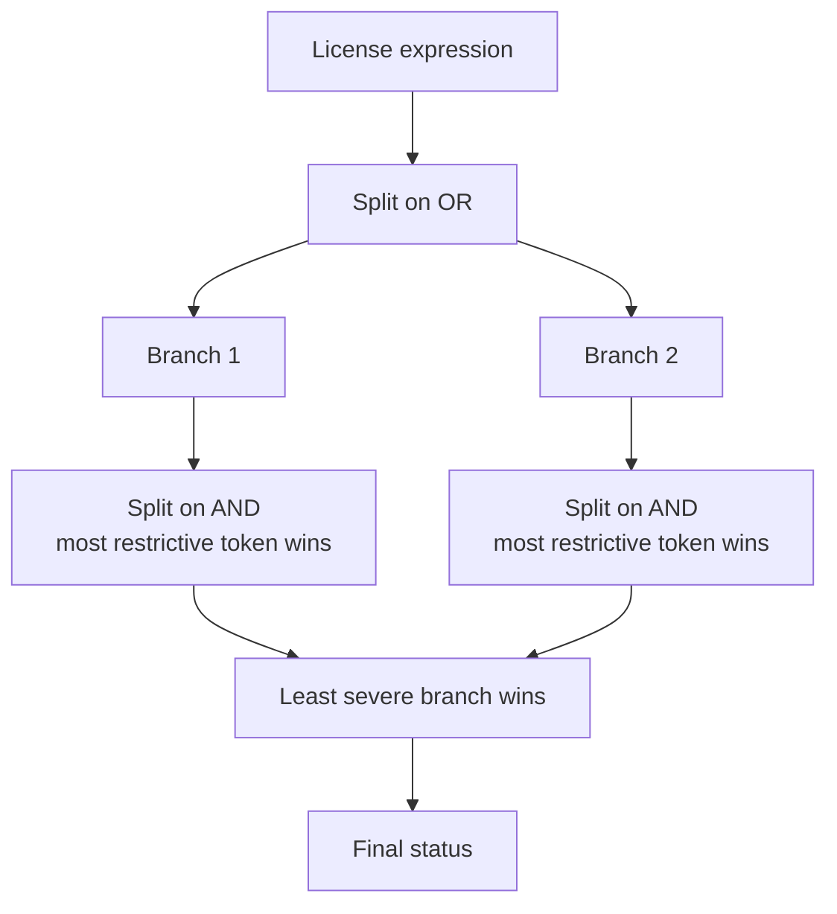

# License Expressions

Many packages are dual-licensed or carry compound terms. LicenseGuard parses SPDX-style expressions and evaluates `OR` and `AND` with the correct semantics.

---

## OR means alternatives

```text
MIT OR GPL-3.0
```

You may choose **either** license. If any alternative satisfies your policy, the package is usable under that alternative.

!!! example "Dual-licensed package"
    Given `MIT OR GPL-3.0` and a policy that approves `MIT` and denies `GPL`:

    - The `MIT` branch is approved.
    - The package is classified <span class="status-approved">APPROVED</span>.

    You take the MIT option. The GPL option is irrelevant to you.

Evaluating OR branches as independent alternatives is what prevents false denials on dual-licensed packages — a naive substring match on the full expression would wrongly flag this as GPL.

---

## AND means cumulative

```text
MIT AND GPL-3.0
```

You must satisfy **all** terms simultaneously. Within an AND group the most restrictive token determines the outcome.

!!! example "Compound obligations"
    Given `MIT AND GPL-3.0` and the same policy:

    - `MIT` is approved, `GPL-3.0` is denied.
    - Most restrictive wins: the group is <span class="status-denied">DENIED</span>.

---

## Combined expressions

Expressions mixing both operators are evaluated as OR across AND-groups:

```text
(MIT AND Apache-2.0) OR GPL-3.0
```

1. Evaluate each OR branch independently.
2. Within a branch, take the most restrictive token.
3. Across branches, take the least restrictive result.

A package is as safe as its safest usable option.

---

## Evaluation within a branch

For each OR branch, rules are applied in severity order — denied, then restricted, then approved — and the most severe match in the branch becomes the branch's result.



If no branch produces a usable result, the package falls through to <span class="status-unknown">UNKNOWN</span>.

---

## Why set semantics matter for drift

Tokenizing expressions into sets — rather than comparing strings — is what makes [drift analysis](../drift/overview.md) meaningful.

Consider an upgrade from `MIT OR Apache-2.0` to `MIT OR GPL-3.0`:

| Approach | Result |
|---|---|
| String comparison | "changed" — true but uninformative |
| Set comparison | `compatible_partial` — `MIT` survives, `Apache-2.0` was replaced by `GPL-3.0` |

The set view tells you that you can still take the MIT option, while flagging that one alternative became materially riskier. That is an actionable distinction a string diff cannot express.

---

## Token normalization

Before comparison, each token passes through the same [normalization pipeline](license-detection.md) used for simple licenses. `MIT License OR Apache Software License 2.0` becomes the token set `{MIT, Apache-2.0}`, so expressions written in different styles compare correctly.

---

## Related

- [Risk classification](risk-classification.md) — how tokens map to statuses
- [Drift analysis](../drift/overview.md) — comparing token sets across releases
- [Policy file format](../policy/policy-file.md) — writing rules that match tokens
