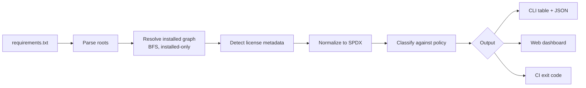

# LicenseGuard

<div class="hero" markdown>

## Dependency License Compliance for Python

**Find out what licenses your dependency tree actually carries.** LicenseGuard resolves only what is installed, normalizes license metadata to SPDX identifiers, classifies risk against your policy, and warns you before an upgrade changes a license underneath you.

[Get Started :material-arrow-right:](getting-started/installation.md){ .md-button .md-button--primary }
[View on GitHub :fontawesome-brands-github:](https://github.com/shanen28/license-guard){ .md-button }

</div>

---

## What Problem Does This Solve?

Dependency trees grow quietly. A single `pip install` can pull in dozens of transitive packages, any of which may carry a license incompatible with how you ship your product — and a package's license can change between releases without anyone noticing.

LicenseGuard turns that invisible risk into a reviewable report:

- **Installed-only truth** — reports on packages actually present in your environment, not merely declared
- **Transitive visibility** — walks the full dependency graph, separating direct from indirect
- **SPDX normalization** — turns messy license metadata into comparable identifiers
- **Policy enforcement** — classify every package as approved, restricted, denied, or unknown
- **Drift detection** — compare installed licenses against the latest PyPI release before you upgrade
- **CI-ready gating** — fail a build on a threshold you choose

!!! warning "Not legal advice"
    LicenseGuard is an engineering aid. It surfaces license metadata and applies rules you define. It does not interpret license terms and is not a substitute for legal review.

---

## Quick Start

=== "Installation"

    ```bash
    pip install licenseguard
    ```

=== "Terminal Scan"

    ```bash
    licenseguard scan requirements.txt --cli
    ```

=== "Web Dashboard"

    ```bash
    licenseguard scan requirements.txt
    ```

=== "CI Gate"

    ```bash
    licenseguard scan requirements.txt \
      --cli --json-only \
      --policy policy.yaml \
      --fail-on restricted
    ```

---

## Key Features

<div class="grid cards" markdown>

-   :material-package-variant-closed:{ .lg .middle } __Installed-Only Resolution__

    ---

    Reads `importlib.metadata` to walk the real dependency graph. Packages declared but not installed are skipped, so results reflect runtime reality instead of a stale requirements file.

    [:octicons-arrow-right-24: How it works](core-concepts/installed-only.md)

-   :material-license:{ .lg .middle } __License Normalization__

    ---

    Extracts license data from `License-Expression`, `License`, and classifier metadata, then normalizes dozens of free-text variations into SPDX-style identifiers.

    [:octicons-arrow-right-24: Detection pipeline](core-concepts/license-detection.md)

-   :material-shield-check:{ .lg .middle } __Policy Classification__

    ---

    Built-in rules cover the common families, or supply a YAML/JSON policy with your own approved, restricted, and denied lists — including family prefixes.

    [:octicons-arrow-right-24: Policy guide](policy/overview.md)

-   :material-chart-timeline-variant:{ .lg .middle } __PyPI Drift Analysis__

    ---

    Opt into `--check-latest` to compare your installed license against the newest release, flagging changes as compatible, partial, or incompatible.

    [:octicons-arrow-right-24: Drift analysis](drift/overview.md)

-   :material-view-dashboard:{ .lg .middle } __Local Dashboard__

    ---

    A dependency-free FastAPI dashboard with filtering, search, an interactive distribution chart, an in-memory policy editor, and JSON/CSV export.

    [:octicons-arrow-right-24: Dashboard guide](dashboard/overview.md)

-   :material-pipe:{ .lg .middle } __CI/CD Integration__

    ---

    Distinct exit codes driven by `--fail-on` make LicenseGuard a drop-in quality gate for pull requests and scheduled governance runs.

    [:octicons-arrow-right-24: Pipeline setup](ci-cd/integration.md)

</div>

---

## How It Works



Each stage lives in its own module, so parsing, resolution, classification, and presentation stay independent.

[:octicons-arrow-right-24: Architecture overview](architecture/overview.md)

---

## Risk Classification at a Glance

| Status | Meaning | Default families |
|---|---|---|
| <span class="status-approved">APPROVED</span> | Permissive, safe to use | MIT, BSD, Apache, ISC, PSF, Unlicense, CC0, Zlib, Boost |
| <span class="status-restricted">RESTRICTED</span> | Usable with obligations; review required | LGPL, MPL, EPL, CPL, CDDL, MS-PL, OSL |
| <span class="status-denied">DENIED</span> | Not acceptable under the active policy | GPL, AGPL, proprietary, commercial, no-redistribution |
| <span class="status-unknown">UNKNOWN</span> | Metadata missing or unrecognized | Anything that fails normalization |

These are the built-in defaults. A policy file overrides them entirely.

[:octicons-arrow-right-24: Classification rules](core-concepts/risk-classification.md)

---

## Audience

This documentation is written for:

- **Python developers** integrating dependency compliance checks into a project
- **Platform and DevOps engineers** building quality gates in CI
- **Security and legal-adjacent reviewers** who need machine-readable reports

---

## Where to Start

=== "New to LicenseGuard"

    1. [Installation](getting-started/installation.md)
    2. [Quickstart](getting-started/quickstart.md)
    3. [Your first scan](getting-started/first-scan.md)

=== "Integrating in CI"

    1. [CLI commands](cli/commands.md)
    2. [Pipeline integration](ci-cd/integration.md)
    3. [Choosing a gate threshold](ci-cd/gating.md)

=== "Designing a policy"

    1. [Policy overview](policy/overview.md)
    2. [Policy file format](policy/policy-file.md)
    3. [Governance patterns](policy/governance.md)

---

## Project Information

| | |
|---|---|
| **Package** | [`licenseguard` on PyPI](https://pypi.org/project/licenseguard/) |
| **Source** | [github.com/shanen28/license-guard](https://github.com/shanen28/license-guard) |
| **License** | MIT |
| **Python** | 3.9+ |
